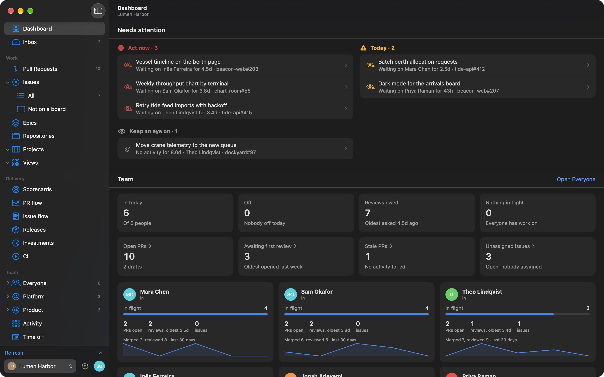
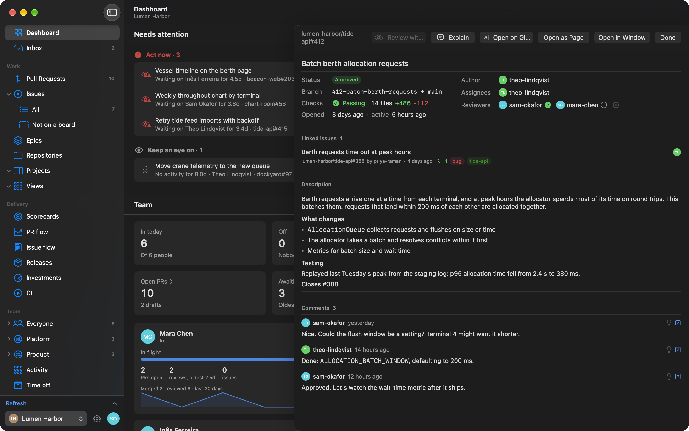
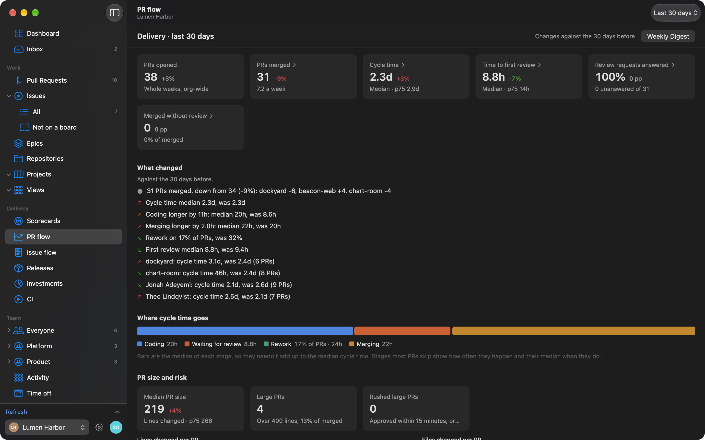
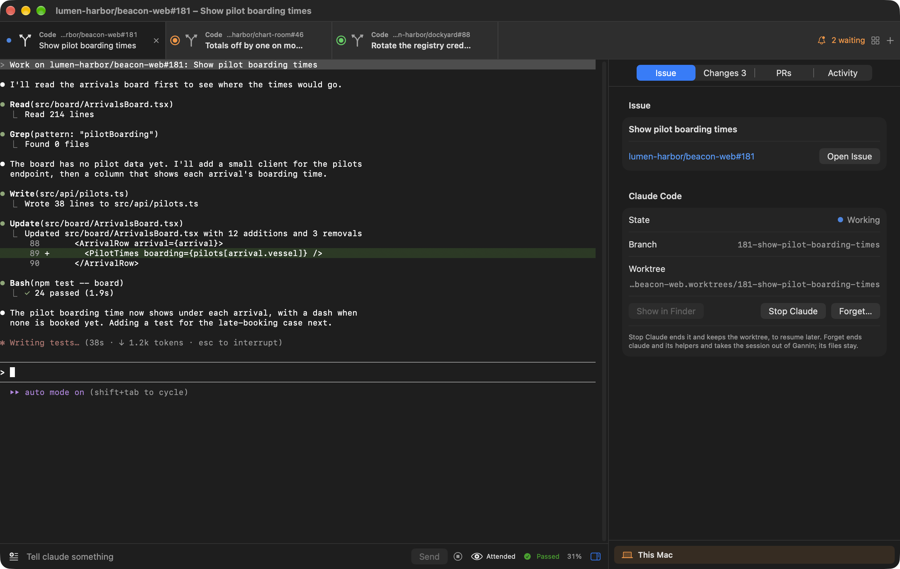

# Gannin

A macOS app for managing workload across your GitHub orgs. Sign in with GitHub, star the orgs
you look after, and see who is working on what: open PRs, review requests, assigned issues and
recently merged work, with PRs linked to the tickets they close.

<picture>
  <source srcset="site/assets/screens/workload-light.png" media="(prefers-color-scheme: light)">
  
</picture>

| | |
| --- | --- |
| <picture><source srcset="site/assets/screens/pull-request-light.png" media="(prefers-color-scheme: light)"></picture> | <picture><source srcset="site/assets/screens/delivery-light.png" media="(prefers-color-scheme: light)"></picture> |
| A pull request in a drawer | PR flow |

<picture>
  <source srcset="site/assets/screens/session-light.png" media="(prefers-color-scheme: light)">
  
</picture>

The screenshots are of the demo build, on invented data; `scripts/capture-screenshots.sh`
refreshes them ([docs/SCREENSHOTS.md](docs/SCREENSHOTS.md)).

## Running

Requires Xcode 26 or later and [XcodeGen](https://github.com/yonaskolb/XcodeGen).

```bash
brew install xcodegen
xcodegen generate
open Gannin.xcodeproj
```

The project is generated from `project.yml` and isn't checked in, so run `xcodegen generate`
again after adding or removing files. To build and test from the command line:

```bash
xcodebuild -project Gannin.xcodeproj -scheme Gannin -destination 'platform=macOS' build
xcodebuild test -project Gannin.xcodeproj -scheme Gannin -destination 'platform=macOS' -skipPackagePluginValidation
```

`scripts/relaunch.sh` builds a signed copy, so it reads the same keychain token, and then
replaces any running Gannin with it. `--no-build` relaunches the last build.

Releases are tags; see [docs/RELEASING.md](docs/RELEASING.md).

## Layout

- `Gannin/`: the app, one folder per feature (`Sessions/`, `Harness/`, `Metrics/`, `Sandbox/`
  and so on). `GanninTests/` holds its unit tests (Swift Testing).
- `docs-site/`: the user docs at [gannin.ai/docs](https://gannin.ai/docs), an Astro Starlight
  site. `npm ci` and `npm run build` there build it, and `npm run dev` serves it. `site/` is
  the landing page.
- `docs/`: notes for people working on Gannin, such as [releasing](docs/RELEASING.md).
- `plans/`, `requirements/`, `learnings/`, `prompts/`, `skills/`, `sessions/`: this repo is also
  its own harness, so the team's plans and the guidance its Claude Code sessions follow live here.
- `Gannin/Demo/`: the demo build's fixtures and screenshot poses, compiled only into the
  `Gannin Demo` target.
- `scripts/`: `relaunch.sh`, `capture-screenshots.sh` and `promote-changelog.sh`.
- `CLAUDE.md` and `.claude/rules/`: guidance for Claude Code. The per-feature rules load when
  it opens files in that feature's folder.

## Claude

Gannin's Claude features (Claude Code sessions, PR reviews, Ask, triage, drafting issues and
rewriting notes) run the official `claude` CLI that's installed and signed in on your Mac, or
on the server you connect to in Settings. They use your own Claude seat, as if you'd run
`claude` yourself.

- Gannin never reads, stores or forwards your Claude login, and never calls Anthropic's API
  with it.
- Claude only runs when you ask: a click, or reopening a session's tab. The background checks
  (review requests, PR checks, session state, diffs) only talk to GitHub.
- Each person uses their own seat. Don't share a Claude login, or a server account signed in
  to one, between people.
- What you share (issues, customer feedback, documents in planning sessions) goes to Claude
  under your account's terms. Use a work seat on your company's Team or Enterprise plan for
  work data.
